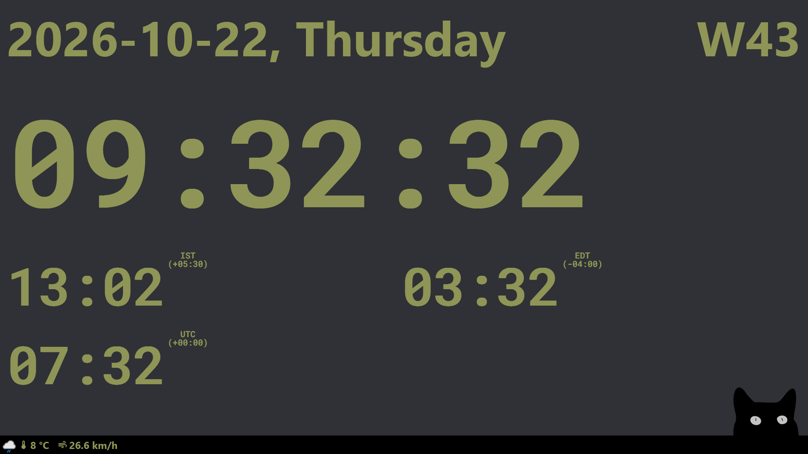

# Mini Dashboard

A full-screen wall dashboard: the time in Amsterdam and the team's other time zones, the date and ISO week, and the
current weather. It runs in Firefox on a Raspberry Pi screen.



## What it shows

**`/`**, the main page:

- Date and ISO week, in Europe/Amsterdam
- Amsterdam time, large, with seconds
- Kolkata, New York and UTC, each with its zone abbreviation and UTC offset
- The current weather in Veghel: condition, temperature and wind, refreshed every 5 minutes. If refreshing fails, the
  last reading stays and is dimmed once it is more than 30 minutes old.
- A gong at :55 every hour from 09:55 to 21:55, Amsterdam time

**`/clock`**: just the date and a full-screen Amsterdam clock.

The browser has to allow autoplay for the dashboard's address, or the gong stays silent.

## Configuration

- `src/config.ts`: the home time zone, the other clocks, the weather location and the gong times
- `WEATHER_API_KEY`: the [weatherapi.com](https://www.weatherapi.com/) API key, read from the environment by the server
  route `/api/weather` on each request. It never reaches the browser. Without it, `/api/weather` returns
  `500 {"error": "WEATHER_API_KEY is not set"}` and the weather bar stays empty.

## Development

Needs Node.js 24 (see `.nvmrc`).

```sh
npm ci
cp .env.example .env.local    # then fill in WEATHER_API_KEY
npm run dev                   # http://localhost:3000
```

| Script                                    | What it does         |
| ----------------------------------------- | -------------------- |
| `npm run dev`                             | Development server   |
| `npm run build`                           | Production build     |
| `npm test` / `npm run test:watch`         | Vitest               |
| `npm run lint`                            | ESLint               |
| `npm run typecheck`                       | TypeScript 7 (`tsc`) |
| `npm run format` / `npm run format:check` | Prettier             |

CI runs lint, the format check, the typecheck, the tests and the build on every pull request.

TypeScript: `typescript` is an alias for `@typescript/typescript6`, because typescript-eslint doesn't support TypeScript
7 yet; `tsc` itself is TypeScript 7 (`@typescript/native`). See the
[TypeScript 7 announcement](https://devblogs.microsoft.com/typescript/announcing-typescript-7-0/#running-side-by-side-with-typescript-6.0).

## Docker

This is how to run a production build: the image uses Next.js' standalone output (`next start` doesn't support it) and
runs as a non-root user (uid 1000) on port 3000.

```sh
docker build -t mini-dashboard .
docker run -p 3000:3000 -e WEATHER_API_KEY=<key> mini-dashboard
```

`.env*` files are excluded from the build context, so the key is never baked into the image; pass it at runtime.

`GET /healthz/live` returns `200 ok` for liveness and readiness probes.

## Deployment

The dashboard is moving from Docker on srv-02 to the k3s homelab cluster, deployed by Argo CD from
[cluster-gitops](https://github.com/fdaniel02/cluster-gitops), with the image on GHCR and the API key in a sealed
secret.
